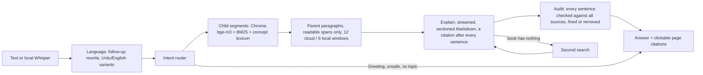

# Mufti AI

A private, multilingual Islamic book assistant with an emerald/ivory responsive interface. Runs at **http://localhost:786**. A numeric port has no leading zero, so requested `0786` is `786`.

## Documentation map

| You are… | Read |
|---|---|
| A new user | **USER_GUIDE.md** (Hinglish + English), then run `.\doctor.ps1` |
| An AI or developer taking over | **AGENTS.md** (entry point) → Handsover.md → TASKS.md → Rules.md |
| Adding a feature | **ADD_FEATURE.md** · catalog of what exists: **FEATURES.md** |
| Fixing something | **REPAIR_PROMPT.md** (copy-paste prompt + triage table) |
| Running commands | **RUN_COMMANDS.md** · design: Architecture.md, Desgin.md, PRD.md · evidence: VERIFICATION.md · decisions: Memory.md |

**New in 2026-11-17:** answer styles (Detailed / Short / Simple words / Study notes), "Ask next"
follow-up questions, chapter explorer with Explain / Summary / Focus, Download & Print, Guide dialog
with setup check, `.\doctor.ps1`, keyboard shortcuts, and automatic handover snapshots. API additions:
`answer_style`, `scope` on `POST /chat`; `followups`, `scope.applied` in responses; `GET /health/setup`,
`GET /books/{id}/outline`, `GET /suggestions`.

## Windows quick start

Already set up? See [RUN_COMMANDS.md](RUN_COMMANDS.md) for everyday start commands and cloud/Gemma settings.

```powershell
cd D:\mufti-ai
python -m venv .venv
.\.venv\Scripts\python.exe -m pip install -r requirements.txt
if (-not (Test-Path .env)) { Copy-Item .env.example .env }
ollama pull qwen3:1.7b
ollama pull bge-m3
.\.venv\Scripts\python.exe -m app.ingestion.indexer
.\start.ps1
```

On macOS/Linux use `python3 -m venv .venv`, activate with `source .venv/bin/activate`, install requirements, then `make ingest` and `make run`. Install Ollama separately and keep it running. Drop additional PDFs into `data/books/` and run ingestion or click **My library → Index library**. Keep books in this folder while you want them searchable. To remove a book completely, remove its PDF and rebuild `data/index/` while the app is stopped. Never run CLI ingestion and API ingestion simultaneously.

## How it works



**Explanation mode (default since 2026-11-16).** Answers are written like a good teacher explains
the book: a direct answer first, then headed sections and bullet points, a short summary, in
English, Urdu, Hindi or Hinglish, with ﷺ and respectful adab. Every factual sentence carries a
`[n]` chip that opens the exact PDF page. The text streams into the chat as it is written; a
second model pass then fact-checks every sentence against the passages and corrects or removes
anything they do not support, and the checked answer replaces the draft. Set
`answer_mode = 'strict'` in `app/core/config.py` for the older claim-by-claim pipeline.

The SQLite LangGraph checkpointer stores up to ten conversation turns in the current state. Prior checkpoints remain until **Delete this conversation** is used; that wipes all checkpoints for the session. Same-session requests are serialized. No question/answer bodies are written to request logs. Embedding caches contain vectors keyed by text hashes; deleting a session removes conversation checkpoints but does not clear these vector caches. Run with `--no-access-log` to avoid Uvicorn session URL logs. Persistent files stay in `data/index/`; Chroma may have its own dependency telemetry defaults, disabled in this app configuration.

## Grounding and practical limits

The model only ever sees book passages, and page numbers are never model-generated: a `[n]` citation is validated in code against the passages actually supplied, and an answer with no valid citation is not shown as a book answer. Cloud answers are audited sentence by sentence (badge: "Fact-checked against the book"); a local-model answer is labelled "Sources linked · not independently fact-checked" because the audit is not run on the 1.7B local model. Source PDF pages are one-based physical PDF pages, not necessarily printed page numbers. A refusal has no fabricated Sources section. Only greetings bypass retrieval. Ruling answers include a scholar referral.

An LLM verifier is a useful filter, not a mathematical guarantee. OCR errors can change wording; inspect original pages for important questions. Tesseract's Urdu Nastaliq recognition can be imperfect. Low-quality pages are flagged and empty/unreadable pages are excluded. The first book has legacy font encoding and requires OCR. Per-page OCR caches permit resuming an interrupted ingestion. Exact quoted passages are preserved; normalization is used only for matching, not displayed original text. Structural headings are inferred from the first line and may include page headers. Chunk size uses characters (about 600–900 English tokens; other scripts vary), and chunks never cross a page boundary.

“OKF” is interpreted as an open knowledge layer: a SQLite keyword/reference-to-passage graph. It links shared topics and verse-like references across books for retrieval; it is deliberately lightweight, not an authoritative scholarly entity graph. Disable via `ENABLE_KNOWLEDGE_GRAPH=false`.

## Configuration and providers

Open **Models & fallback** to choose Auto, a preferred cloud provider, or Ollama only. Auto defaults to **Anthropic → OpenAI → Gemini → Ollama**. Change cloud priorities and model IDs in the dialog; the selected installed Ollama model (including Gemma) is always the final option. Gemini is Google's cloud API; Gemma runs locally through Ollama. Settings apply to new questions and stay fixed throughout an answer. `EMBEDDING_MODEL=bge-m3` stays local and is independent of answering providers. Changing the embedding model requires reingestion; do not mix dimensions in an existing Chroma collection (use a fresh index).

Cloud providers are optional. Store `ANTHROPIC_API_KEY`, `OPENAI_API_KEY`, and/or `GOOGLE_API_KEY` in `.env`, then restart. The browser receives only key availability. Cloud modes send questions, recent conversation context and selected PDF excerpts to configured providers as needed; the dialog explains this when saving. Providers without keys are skipped. Quota (429), timeout, and server failures get up to two attempts; invalid credentials/model IDs move immediately to the next provider. Failed clouds cool down for 60 seconds. Ollama is still attempted even if its circuit was cooling down. A local answer requires Ollama running and the selected model installed. Actual cloud quotas cannot be known in advance; fallback follows provider responses. Model choices persist without secrets in `model-settings.json`; `.env` and `config.yaml` supply initial defaults. `/health/providers` checks availability without generation. Optional cross-encoder: install `requirements-optional.txt`, set `ENABLE_RERANKER=true`; the first use downloads `BAAI/bge-reranker-v2-m3`. With it disabled, relevance uses dense cosine similarity, with BM25/RRF for ordering. Tune `RERANK_THRESHOLD` against your own evaluation set.

## OCR and voice

Windows: install Tesseract (UB Mannheim), then language packs `urd`, `ara`, `hin`, `eng`. The installer may supply only English. Store traineddata files in `data/tessdata/` or configure Tesseract's system data directory. Linux: `apt install tesseract-ocr tesseract-ocr-urd tesseract-ocr-ara tesseract-ocr-hin tesseract-ocr-eng`; macOS: `brew install tesseract tesseract-lang`. OCR caches are keyed by file SHA256; delete the relevant `data/index/ocr-cache/` directory to re-OCR after changing language models. Four OCR workers are used with one OpenMP thread each. Urdu books use Urdu + English recognition to avoid introducing unrelated Hindi glyphs; other installed packs are available for future language-specific configuration. Better `urd-best.traineddata` is selected when present.

Mic defaults to local Whisper. The About dialog can enable optional browser recognition with live transcript. Browser recognition can use the browser vendor's online speech service; auto mode defaults to Urdu, select Hindi/English as needed. In local mode, MediaRecorder uploads audio only to the local faster-whisper endpoint. faster-whisper is included in the main requirements; the first transcription downloads the Whisper model. No server TTS is enabled; read aloud uses browser SpeechSynthesis and depends on installed voices. Web fonts are optional; fallback fonts work offline. OpenAI Whisper and server TTS are not configured.

## API

Model settings: `GET /settings/models` returns current non-secret choices, configured-key flags, and installed chat models; `PUT /settings/models` accepts only `{mode, cloud_order, models}`. Chat responses also include `model_used` and `fallback_used`. The selected model applies to every agent; legacy per-task model overrides are no longer used.

Provider payloads follow [official OpenAI structured-output documentation](https://developers.openai.com/api/docs/guides/structured-outputs?api-mode=chat), [Anthropic's Messages API](https://platform.claude.com/docs/en/api/messages/create), and [Gemini's GenerateContent API](https://ai.google.dev/api/generate-content). Real cloud access depends on your keys and model permissions.

`POST /chat` accepts `{ "question":"...", "session_id":"my-session", "language_hint":"auto", "stream":true }`. Languages: auto, Hindi, Urdu, English, Hinglish. Response: answer, language, citations, provider_used, grounded, latency_ms, status. SSE emits status/keepalive events while processing and verified text chunks after verification; raw unverified tokens are never displayed. Other routes: `POST /voice` (multipart audio), `POST /ingest` (background), `GET /books`, `GET /health`, `GET /health/providers`, `GET /sessions/{id}`, `DELETE /sessions/{id}`, `GET /books/{id}/pages/{page}`, `GET /books/{id}/pdf`. Mutation endpoints are rate-limited to 15/minute per local address; maximum audio is 20 MB. Bind to loopback; this is a personal app without user authentication.

## MCP

```powershell
.\.venv\Scripts\python.exe -m mcp_server.server
.\.venv\Scripts\python.exe -m mcp_server.server --transport streamable-http
```

Tools: `search_books`, `get_page`, `list_books`, `ask_mufti`; resource `books://catalog`. Example stdio client config:

```json
{"mcpServers":{"mufti-library":{"command":"D:\\mufti-ai\\.venv\\Scripts\\python.exe","args":["-m","mcp_server.server"],"cwd":"D:\\mufti-ai"}}}
```

For clients without `cwd`, set `PYTHONPATH` to `D:\mufti-ai` in their MCP environment. For app-to-MCP retrieval, start the HTTP MCP server and set `RETRIEVER_MCP_URL=http://localhost:8000/mcp`. The MCP tool uses direct local retrieval to avoid recursion.

## Tests and evaluation

```powershell
.\.venv\Scripts\python.exe -m pytest -q
.\.venv\Scripts\python.exe eval/run_eval.py
```

Tests (250 as of 2026-11-17; `testpaths = tests`) run offline with deterministic provider doubles: Hindi/Urdu/English/Hinglish detection, fixture PDF parsing, page metadata, RRF, missing keys/429/timeouts, circuit breaker, fabricated citation rejection, unrelated-question refusal and an end-to-end evidence answer. Evaluation has 22 editable questions and reports verified-answer coverage, exact citation validity, detected/requested language match, latency and providers. These metrics do not replace a scholar's manual factual review. Live self-check output is stored separately when performed.

## Docker

`docker compose up --build -d`; then `docker compose exec ollama ollama pull qwen3:1.7b`, `docker compose exec ollama ollama pull bge-m3`, and `docker compose exec api python -m app.ingestion.indexer`. Frontend is served by FastAPI, Chroma is embedded, and Ollama is a separate service. The optional cross-encoder dependencies are excluded from the base image.

## Troubleshooting

- Ollama offline: start Ollama, check `/health/providers` and model names with `ollama list`.
- Index failure: open My library and inspect `/health`; check `server-error.log`. Existing working indexes remain available on embedding failure.
- OCR empty/garbled: inspect original PDF page, verify Urdu traineddata, increase render DPI or use better traineddata and clear page OCR cache.
- Urdu RTL: install an Urdu font such as Noto Nastaliq Urdu. Hindi uses Devanagari; English/Hinglish use LTR.
- Insufficient RAM: close unused apps, leave cross-encoder disabled, use a small chat model. Embedding and chat models may swap on low-memory computers.
- Restart: run `start.ps1` from the project directory. The server listens only on your computer at port 786.
